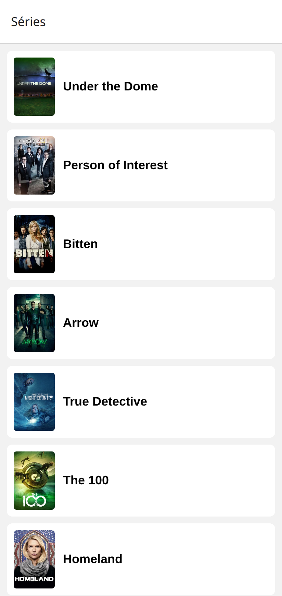
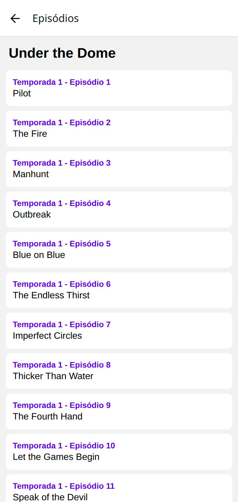

# Checkpoint 3  Séries TVmaze (React Native)

Aplicativo React Native (Expo) que consome a API pública [TVmaze](https://www.tvmaze.com/api) para listar séries e mostrar os episódios de cada uma.

## Telas

| Listagem de séries | Detalhe com episódios |
| --- | --- |
|  |  |

- **HomeScreen**: busca `https://api.tvmaze.com/shows` e mostra a imagem e o nome de cada série.
- **DetalhesScreen**: recebe o `id` e o `nome` da série por `route.params` e busca `https://api.tvmaze.com/shows/${id}/episodes`. Cada episódio mostra temporada, número e nome.

## Requisitos atendidos

- Navegação com Stack Navigator (`@react-navigation/native-stack`) em `App.js`.
- Listas com `FlatList` nas duas telas.
- Dados obtidos com `fetch` dentro de `useEffect`, usando `async/await`.
- `try/catch/finally` para tratar erros e encerrar o carregamento.
- `ActivityIndicator` durante o carregamento e mensagem em caso de erro nas duas telas.
- `id` da série enviado por parâmetro de navegação e usado na URL com template literal.
- Séries sem imagem (`image: null`) mostram "Sem imagem" em vez de quebrar o app.

## Estrutura

```
App.js                        # navegação (Stack Navigator)
src/screens/HomeScreen.js     # listagem de séries
src/screens/DetalhesScreen.js # episódios da série
```

## Como executar

```bash
npm install
npx expo start
```

Depois, abra no Expo Go (Android/iOS) lendo o QR code, ou pressione `w` para abrir no navegador.
